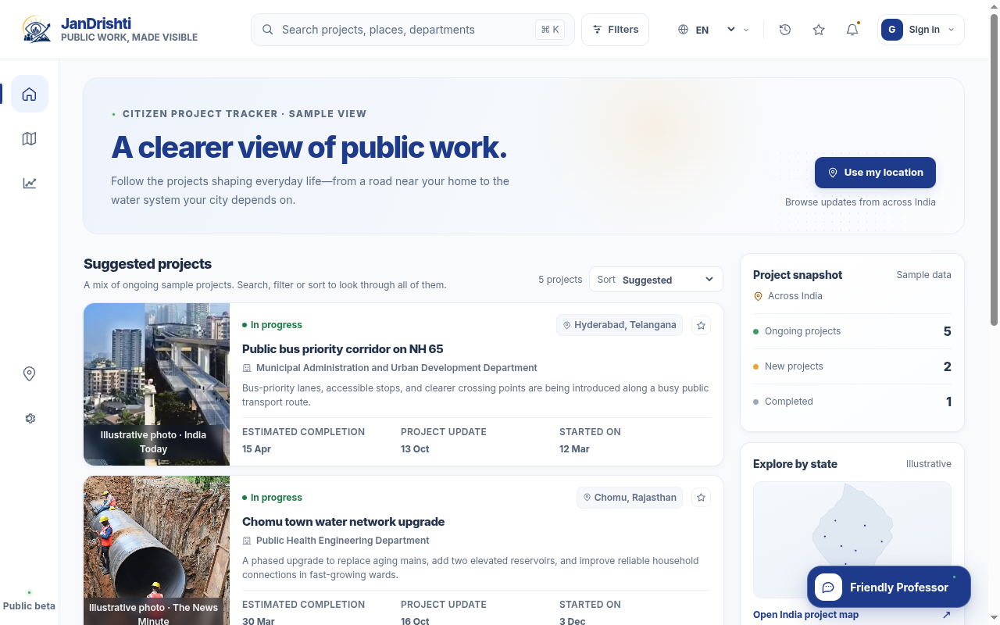
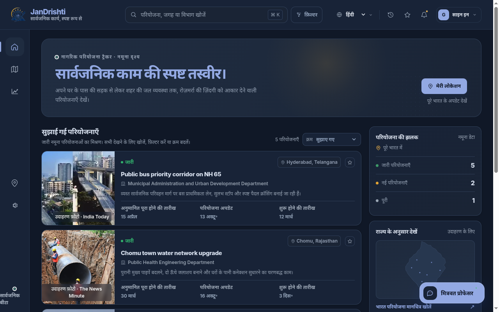
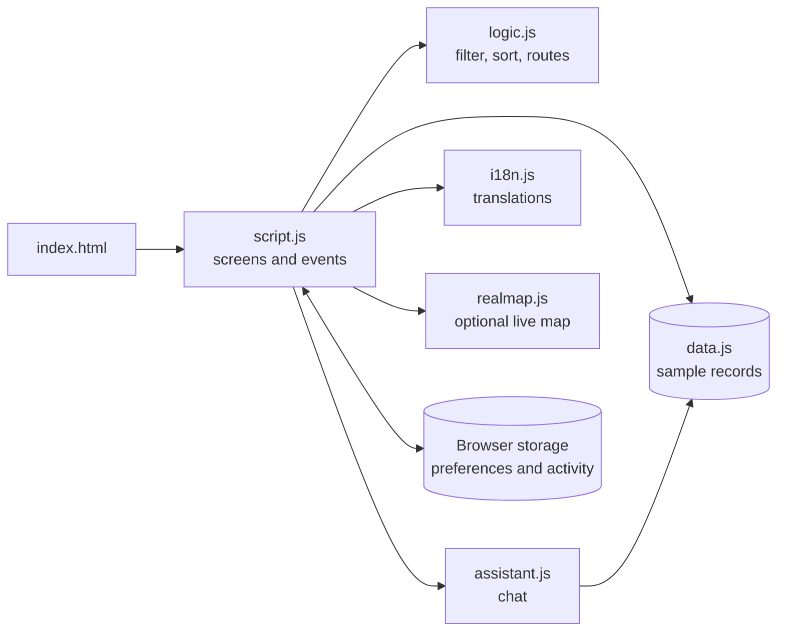

# JanDrishti

**Public work, made visible.** A responsive, multilingual web app for finding and following civic projects in India.

[](https://github.com/riddhimamathur/JanDrishti/actions/workflows/checks.yml)

[**Live demo**](https://jandrishti-five.vercel.app/) · [Developer guide](DEVELOPMENT.md) · [Image sources](ASSET-SOURCES.md)



> [!NOTE]
> JanDrishti is a prototype. Its projects, updates and notifications are fictional sample records, not government data.

## Contents

- [Features](#features)
- [Quick start](#quick-start)
- [Architecture](#architecture)
- [Quality checks](#quality-checks)
- [Current limitations](#current-limitations)
- [Roadmap](#roadmap)
- [Contributing](#contributing)
- [License and credits](#license-and-credits)

## Features

| Area | What you can do |
|---|---|
| **Discover** | Search by project, place or department; filter by department, state, district and start date; sort the results |
| **Nearby** | Share your location to see the closest projects first |
| **Follow** | Read project progress and dated updates, star projects and revisit recently viewed ones |
| **Map** | Browse projects by state and district on a schematic map |
| **Friendly Professor** | Ask about sample projects in a floating or full-screen chat |
| **Languages** | English, हिन्दी, ગુજરાતી, मराठी, ଓଡ଼ିଆ, বাংলা, తెలుగు and ಕನ್ನಡ |
| **Comfort** | Light and dark themes, phone-friendly layouts, keyboard support and shareable page links |

Sign-in, notifications and feedback forms are demonstrations only.



## Quick start

You need Python 3 (or any other static file server).

```bash
git clone https://github.com/riddhimamathur/JanDrishti.git
cd JanDrishti
python3 -m http.server 8000
```

Open <http://localhost:8000>. The compiled stylesheet is included, so viewing the app needs no install or build.

To run the tests and create a production build, use Node.js 24 and pnpm 10:

```bash
pnpm install --frozen-lockfile
pnpm test
pnpm run build     # output in public/
```

## Architecture

JanDrishti is a static front end with no application server or database. It is written in HTML, CSS and vanilla JavaScript (ES modules), styled with hand-written CSS processed by Tailwind CSS 3, and configured for deployment on Vercel.



| Path | Purpose |
|---|---|
| `index.html` | Page structure |
| `script.js` | Screens, dialogs and event handling |
| `logic.js` | Filtering, sorting, distance and page addresses |
| `assistant.js` | Friendly Professor chat |
| `i18n.js` | Interface translation |
| `data.js` | Sample projects, places and core translations |
| `realmap.js` | Live map integration, currently switched off |
| `styles.input.css` | Style source; `styles.css` is the compiled copy |
| `tests/` | Automated tests |

**About the assistant:** Friendly Professor matches keywords against the sample records. It is not an AI model and does not remember earlier questions.

**Privacy:** there is no JanDrishti server to receive your data. Preferences, starred projects, viewing history and the demo sign-in stay in your browser. Fonts are loaded from Google Fonts.

## Quality checks

Tests use Node's built-in test runner and cover the feed logic, chat matching, translations, sample data and the map switch. GitHub Actions runs them on every push and pull request, builds the site and confirms that the committed `styles.css` matches the build.

## Current limitations

- All content is sample data, and the district lists are partial and unverified.
- Newer translations are machine drafts that need review by native speakers.
- Project titles, departments, places and older updates are shown in English.
- The map is a rough illustration, not to scale, and should not be used as a reference for boundaries.
- Photos are illustrative; some do not match their project, and their reuse rights are unconfirmed.

## Roadmap

- [ ] Native-speaker review of all translations
- [ ] Openly licensed photos that match each project
- [ ] District lists checked against an official source
- [ ] Live map, once India's boundaries are drawn from official data and verified (see the [developer guide](DEVELOPMENT.md#live-map-switched-off))
- [ ] Testing on physical devices and with screen readers

## Contributing

1. Create a branch from `main`.
2. Make your change. If you edit `styles.input.css`, build and copy `public/styles.css` over `styles.css`.
3. Run `pnpm test` and `pnpm run build`.
4. Open a pull request. Please do not force push.

See the [developer guide](DEVELOPMENT.md) for details.

## License and credits

This repository does not currently include a license, so no permission to reuse its code or assets is granted by default. Contact the repository owner, [@riddhimamathur](https://github.com/riddhimamathur), before reusing it.

Photo publishers are credited in [ASSET-SOURCES.md](ASSET-SOURCES.md).
