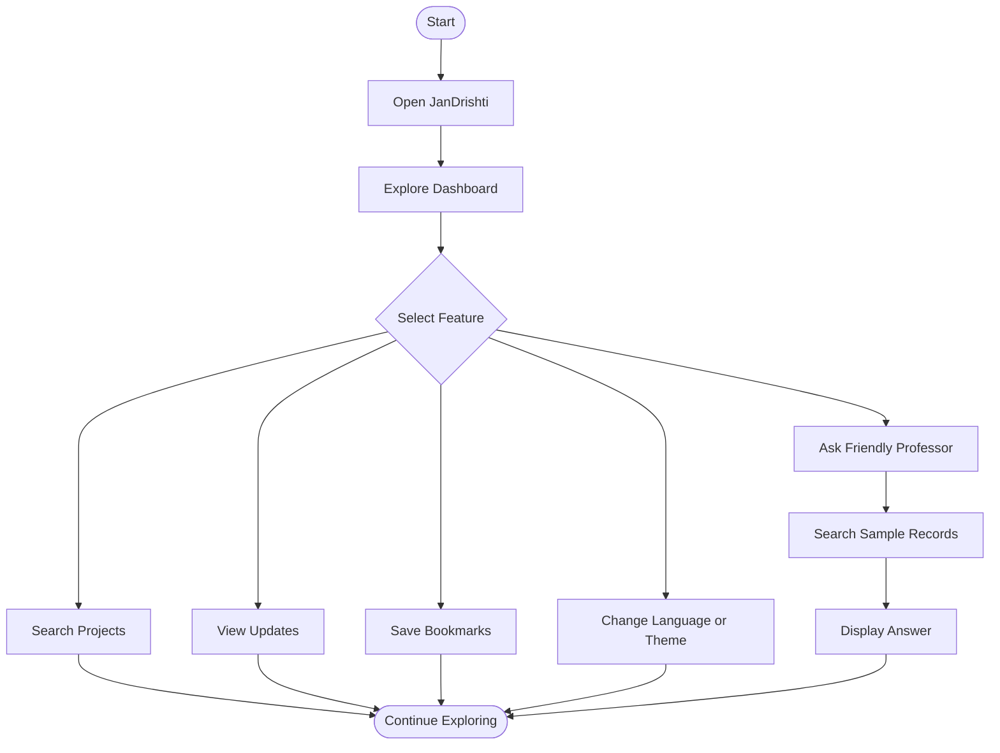
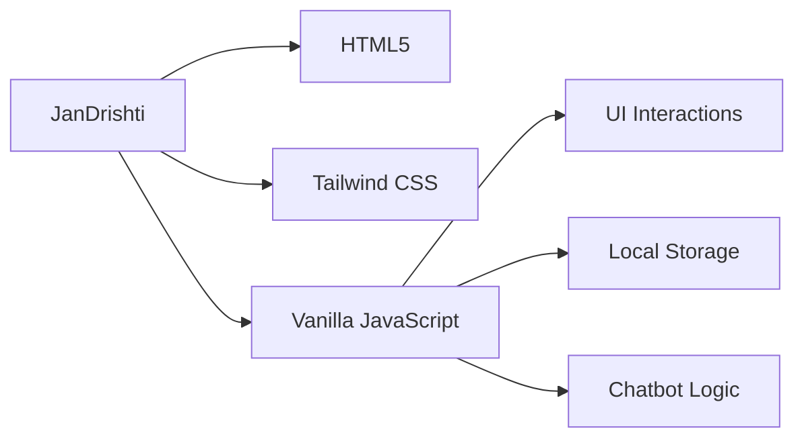
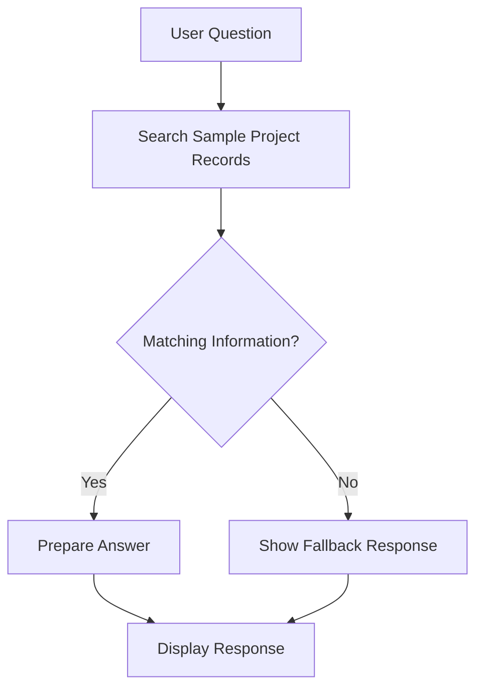

# 🇮🇳 JanDrishti — Civic Project Tracker

**A responsive, multilingual dashboard prototype for exploring civic projects and their updates.**

JanDrishti is built using HTML5, Tailwind CSS, and Vanilla JavaScript to make civic project information easier to explore and understand.

## ✨ Features

- 📊 Activity feed with project updates
- 🔍 Project search and filters
- 🗺️ Schematic India map
- 🌐 8 Indian language options
- 🔖 Bookmarks and browsing history
- 🔔 Notifications and mock sign-in
- 🎨 Theme settings
- 🤖 Friendly Professor chatbot
- 💬 Full-screen chat and floating widget
- 📝 Feedback forms
- 📱 Responsive interface

## 🔄 Project Workflow

## 🛠️ Tech Stack

- **HTML5:** Page structure
- **Tailwind CSS:** Responsive styling
- **Vanilla JavaScript:** Interactions, localization, and chatbot logic
- **Local Storage:** Demo preferences and user activity

## 🤖 Friendly Professor

The assistant uses predefined lookup logic, not a live AI model.
**JanDrishti 🇮🇳 — Explore. Understand. Stay Informed.**
